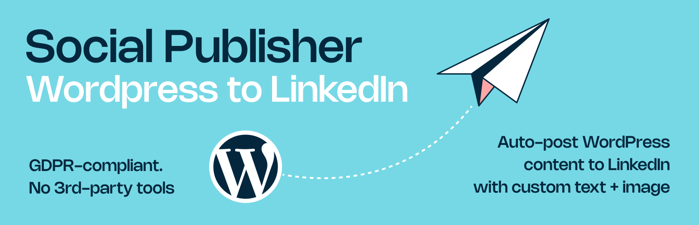

  <a href="README.md">🇩🇪 Deutsch</a> · 🇬🇧 English

  

<h1 align="center">Social Publisher – Auto Post to LinkedIn</h1>

  <strong>Publish WordPress posts to LinkedIn straight from the editor – to personal profiles and company pages.</strong> 
  With a dedicated LinkedIn text, live preview and a tracking-free, GDPR-friendly login.

  
  
  
  
  
  

  <a href="https://wordpress.org/plugins/social-publisher/"><strong>Download</strong></a> ·
  <a href="https://social-publisher.enfants.de/">Website</a> ·
  <a href="https://wordpress.org/plugins/social-publisher/#developers">Changelog</a> ·
  <a href="https://wordpress.org/support/plugin/social-publisher/">Support</a>

---

## Why Social Publisher?

Social Publisher does one thing: **WordPress to LinkedIn**. No other networks, no separate dashboard, no account with us. You write a dedicated LinkedIn text in the editor, choose an image, check the preview, and publish to your site. The post goes out to LinkedIn automatically shortly afterwards.

Built by an agency that got tired of the copy-paste routine. We use it ourselves every week.

**For social media managers and agencies:** install Social Publisher on each client's WordPress site and set a dedicated Brand Voice per client (PRO). LinkedIn content is created where it is written.

## Features

### Free

- Auto-publish to LinkedIn when you hit "Publish"
- Dedicated LinkedIn text, separate from the blog post
- Separate LinkedIn image (JPG/PNG)
- Live preview of the LinkedIn post in the editor
- Personal profiles and company pages
- LinkedIn login through a tracking-free OAuth proxy
- Sharing status per post (queued, shared, error) in the editor and post list, with the reason and a fix hint on errors

### PRO

- **AI rewriting** with tone presets (informational, emotional, salesy) and your own **Brand Voice**, using your own OpenAI API key
- **Scheduling** for a specific date and time, delivered by a background queue
- **Reposting:** schedule an already published post to go out on LinkedIn again
- **PDF carousel:** attach a PDF instead of an image
- Optional backlink to your post

## Screenshots

<table>
  <tr>
    <td width="50%"> Settings: profile selection, license, OpenAI key and Brand Voice</td>
    <td width="50%"> Editor with LinkedIn text, media, AI options, scheduling and live preview</td>
  </tr>
  <tr>
    <td width="50%"> PRO: original and rewritten text side by side</td>
    <td width="50%"> Live preview of how the post appears on LinkedIn</td>
  </tr>
  <tr>
    <td width="50%"> Post list with LinkedIn column</td>
    <td width="50%"> Filters and LinkedIn metadata per post</td>
  </tr>
</table>

## Install

1. In WordPress, go to **Plugins → Add New** and search for **Social Publisher**, or [download it from WordPress.org](https://wordpress.org/plugins/social-publisher/).
2. Activate the plugin.
3. Open **Settings → Social Publisher** and connect your LinkedIn account.
4. When writing a post, enable LinkedIn sharing and set the text and image.

**Requirements:** WordPress 6.8+, PHP 7.4+.

## Free vs. PRO

| | Free | PRO |
|---|:---:|:---:|
| Auto-post to LinkedIn (profile and company page) | ✅ | ✅ |
| Dedicated LinkedIn text and image | ✅ | ✅ |
| Live preview in the editor | ✅ | ✅ |
| AI rewriting with Brand Voice | | ✅ |
| Scheduling | | ✅ |
| Reposting published posts | | ✅ |
| PDF carousel | | ✅ |

PRO costs **9 EUR per month per site** and can be cancelled at any time. Early adopters keep their entry price for as long as their subscription runs.

## Privacy (GDPR)

The LinkedIn login runs through an OAuth proxy at `social-publisher.enfants.de`. No LinkedIn script, cookie or tracking pixel is loaded on your site.

The full list of connections is in the "External services" section of the [plugin page on WordPress.org](https://wordpress.org/plugins/social-publisher/). In short: the LinkedIn API for connecting and publishing; with a PRO license, a daily license check and the update check; text and Brand Voice go to OpenAI with your own key only when you click "Rewrite". There is also an optional, anonymous feedback survey. For the AI feature you may need a data processing agreement with OpenAI.

## Source and license

The free plugin is open source under **GPL-2.0 or later** and is distributed through [WordPress.org](https://wordpress.org/plugins/social-publisher/). The source is not published in this repository, which only holds the README, screenshots and links. PRO is a separate commercial offering.

LinkedIn is a trademark of LinkedIn Corporation. Social Publisher is not affiliated with, endorsed or sponsored by LinkedIn.

## Links and support

- Website: [social-publisher.enfants.de](https://social-publisher.enfants.de/)
- Support forum: [wordpress.org/support/plugin/social-publisher](https://wordpress.org/support/plugin/social-publisher/)
- The same team builds [IMG Performer](https://github.com/enfants-terribles/img-performer): WebP/AVIF and EU AI Act image labeling
- Made by [enfants terribles](https://enfants.de), Hamburg
