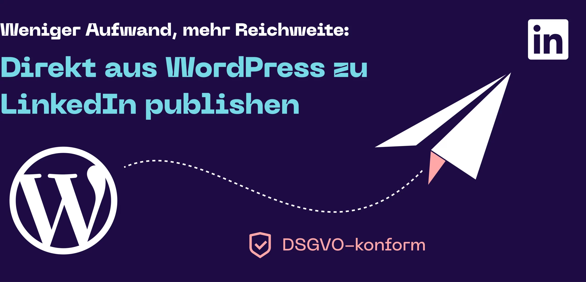
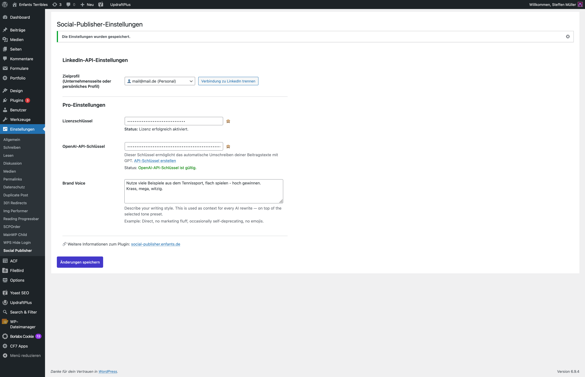
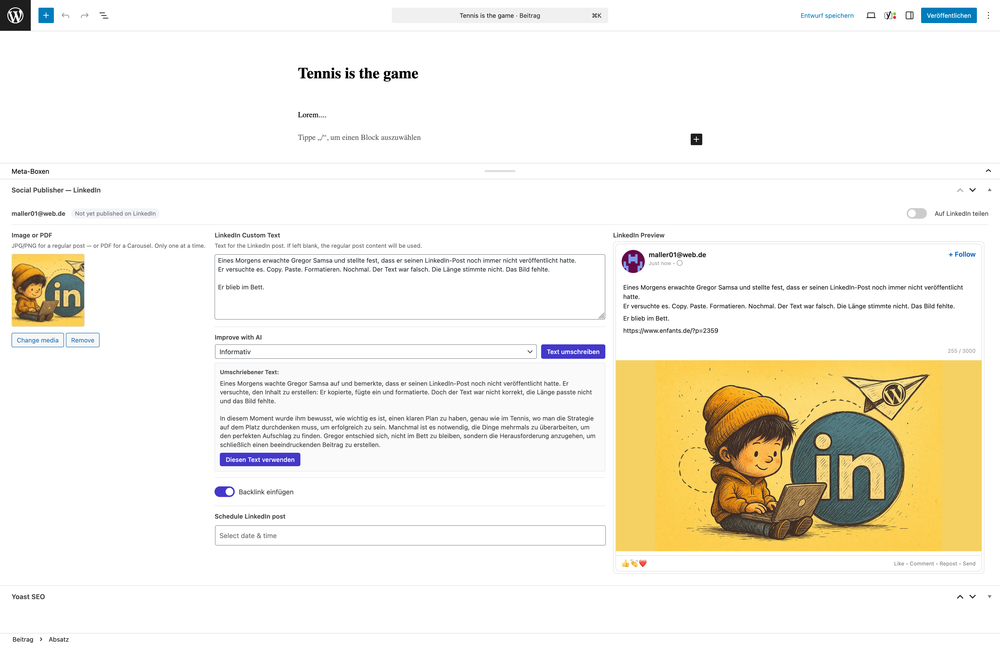
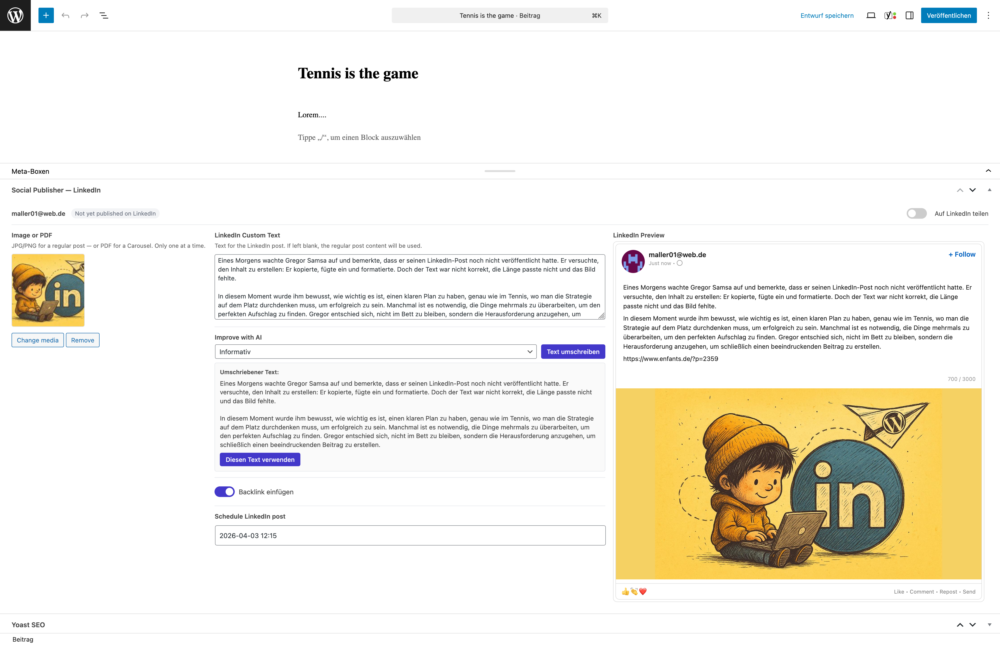
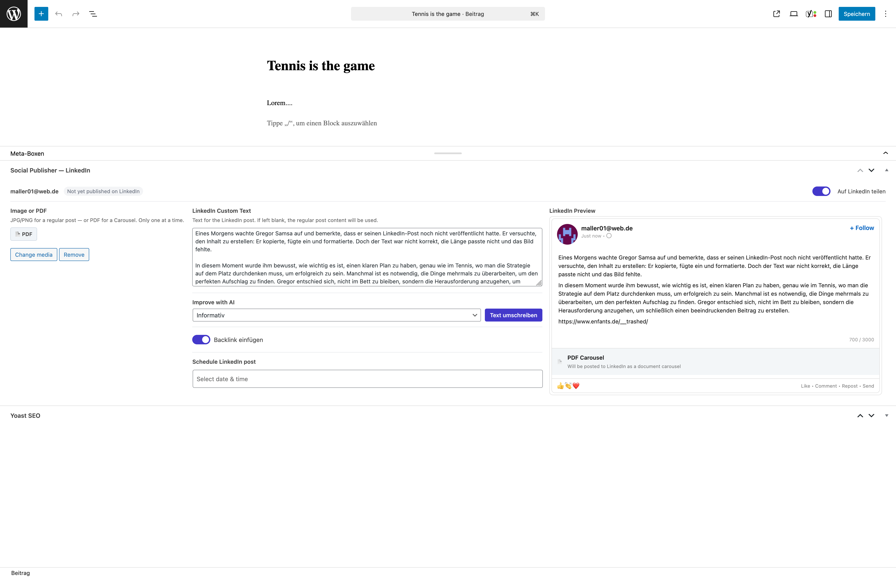
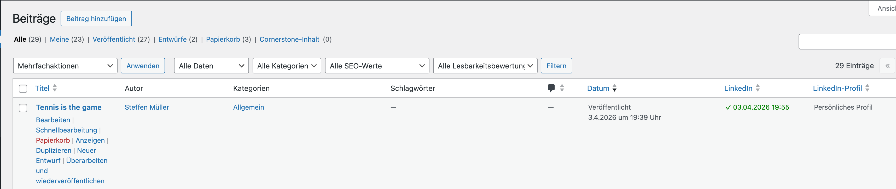
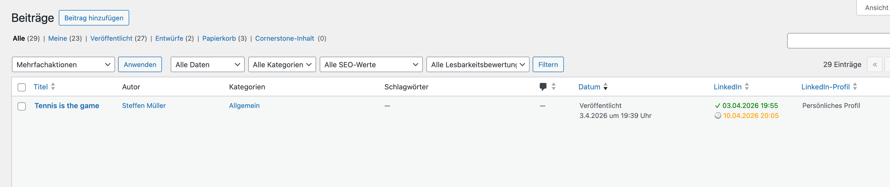

  🇩🇪 Deutsch · <a href="README.en.md">🇬🇧 English</a>

  

<h1 align="center">Social Publisher – Auto Post to LinkedIn</h1>

  <strong>WordPress-Beiträge direkt aus dem Editor auf LinkedIn veröffentlichen – auf persönliche Profile und Unternehmensseiten.</strong> 
  Mit eigenem LinkedIn-Text, Bildvorschau und DSGVO-freundlichem Login ohne Tracking.

  
  
  
  
  
  

  <a href="https://wordpress.org/plugins/social-publisher/"><strong>Download</strong></a> ·
  <a href="https://social-publisher.enfants.de/">Website</a> ·
  <a href="https://wordpress.org/plugins/social-publisher/#developers">Changelog</a> ·
  <a href="https://wordpress.org/support/plugin/social-publisher/">Support</a>

---

## Warum Social Publisher?

Social Publisher macht eine Sache: **WordPress nach LinkedIn**. Keine weiteren Netzwerke, kein separates Dashboard, kein Konto bei uns. Sie schreiben im Editor einen eigenen LinkedIn-Text, wählen ein Bild, sehen die Vorschau und veröffentlichen mit „Veröffentlichen" auf der Website. Der Beitrag geht kurz darauf automatisch auch auf LinkedIn.

Entwickelt von einer Agentur, der das Kopieren zwischen CMS und LinkedIn zu lästig wurde. Wir setzen das Plugin selbst jede Woche ein.

**Für Social-Media-Manager und Agenturen:** Installieren Sie Social Publisher auf der WordPress-Seite jedes Kunden und hinterlegen Sie pro Kunde eine eigene Brand Voice (PRO). So entsteht der LinkedIn-Inhalt dort, wo er geschrieben wird.

## Funktionen

### Kostenlos

- Automatisch auf LinkedIn veröffentlichen, sobald Sie „Veröffentlichen" klicken
- Eigener LinkedIn-Text, unabhängig vom Blogbeitrag
- Eigenes LinkedIn-Bild (JPG/PNG)
- Live-Vorschau des LinkedIn-Posts im Editor
- Persönliche Profile und Unternehmensseiten
- LinkedIn-Login über einen OAuth-Proxy ohne Tracking
- Status je Beitrag (in Warteschlange, geteilt, Fehler) im Editor und in der Beitragsliste, bei Fehlern mit Ursache und Hinweis zur Behebung

### PRO

- **KI-Umschreiben** mit Tonalität (informativ, emotional, vertriebsorientiert) und eigener **Brand Voice**, mit Ihrem eigenen OpenAI-API-Schlüssel
- **Planung** auf Datum und Uhrzeit, zuverlässig über eine Hintergrund-Warteschlange
- **Repost:** einen bereits veröffentlichten Beitrag erneut auf LinkedIn einplanen
- **PDF-Karussell:** ein PDF statt eines Bildes anhängen
- Optionaler Backlink zum Beitrag

## Screenshots

<table>
  <tr>
    <td width="50%"> Einstellungen: Profilauswahl, Lizenz, OpenAI-Schlüssel und Brand Voice</td>
    <td width="50%"> Editor mit LinkedIn-Text, Medien, KI-Optionen, Planung und Live-Vorschau</td>
  </tr>
  <tr>
    <td width="50%"> PRO: Originaltext und umgeschriebener Text nebeneinander</td>
    <td width="50%"> Live-Vorschau, wie der Beitrag auf LinkedIn aussieht</td>
  </tr>
  <tr>
    <td width="50%"> Beitragsliste mit LinkedIn-Spalte</td>
    <td width="50%"> Filter und LinkedIn-Metadaten je Beitrag</td>
  </tr>
</table>

## Installation

1. Im WordPress-Backend unter **Plugins → Neu hinzufügen** nach **Social Publisher** suchen, oder [auf WordPress.org herunterladen](https://de.wordpress.org/plugins/social-publisher/).
2. Plugin aktivieren.
3. Unter **Einstellungen → Social Publisher** Ihr LinkedIn-Konto verbinden.
4. Beim Schreiben eines Beitrags die LinkedIn-Freigabe aktivieren und Text sowie Bild festlegen.

**Voraussetzungen:** WordPress 6.8+, PHP 7.4+.

## Kostenlos oder PRO

| | Kostenlos | PRO |
|---|:---:|:---:|
| Auto-Post zu LinkedIn (Profil und Unternehmensseite) | ✅ | ✅ |
| Eigener LinkedIn-Text und -Bild | ✅ | ✅ |
| Live-Vorschau im Editor | ✅ | ✅ |
| KI-Umschreiben mit Brand Voice | | ✅ |
| Planung auf Datum und Uhrzeit | | ✅ |
| Repost bereits veröffentlichter Beiträge | | ✅ |
| PDF-Karussell | | ✅ |

PRO kostet **9 € pro Monat und Website** und ist jederzeit kündbar. Early Adopters behalten ihren Einstiegspreis, solange das Abonnement läuft.

## Datenschutz (DSGVO)

Der LinkedIn-Login läuft über einen OAuth-Proxy unter `social-publisher.enfants.de`. Auf Ihrer Website werden kein LinkedIn-Skript, kein Cookie und kein Tracking-Pixel geladen.

Die vollständige Liste aller Verbindungen steht im Abschnitt „External services" der [Plugin-Seite auf WordPress.org](https://de.wordpress.org/plugins/social-publisher/). Kurz gesagt: LinkedIn-API zum Verbinden und Veröffentlichen; mit PRO-Lizenz einmal täglich die Lizenzprüfung und die Update-Abfrage; nur bei einem Klick auf „Umschreiben" gehen Text und Brand Voice mit Ihrem eigenen Schlüssel an OpenAI. Außerdem gibt es eine optionale, anonyme Feedback-Umfrage. Für die KI-Funktion brauchen Sie gegebenenfalls einen Auftragsverarbeitungsvertrag (AVV) mit OpenAI.

## Quellcode und Lizenz

Das kostenlose Plugin ist Open Source unter **GPL-2.0 oder neuer** und wird über [WordPress.org](https://de.wordpress.org/plugins/social-publisher/) verteilt. Der Quellcode liegt nicht in diesem Repository. Es enthält nur README, Screenshots und Links. PRO ist ein eigenes, kommerzielles Angebot.

LinkedIn ist eine Marke der LinkedIn Corporation. Social Publisher steht in keiner Verbindung zu LinkedIn und wird weder von LinkedIn unterstützt noch gesponsert.

## Links und Support

- Website: [social-publisher.enfants.de](https://social-publisher.enfants.de/)
- Support-Forum: [wordpress.org/support/plugin/social-publisher](https://wordpress.org/support/plugin/social-publisher/)
- Dasselbe Team entwickelt auch [IMG Performer](https://github.com/enfants-terribles/img-performer): WebP/AVIF und KI-Bildkennzeichnung nach EU AI Act
- Entwickelt von [enfants terribles](https://enfants.de), Hamburg
